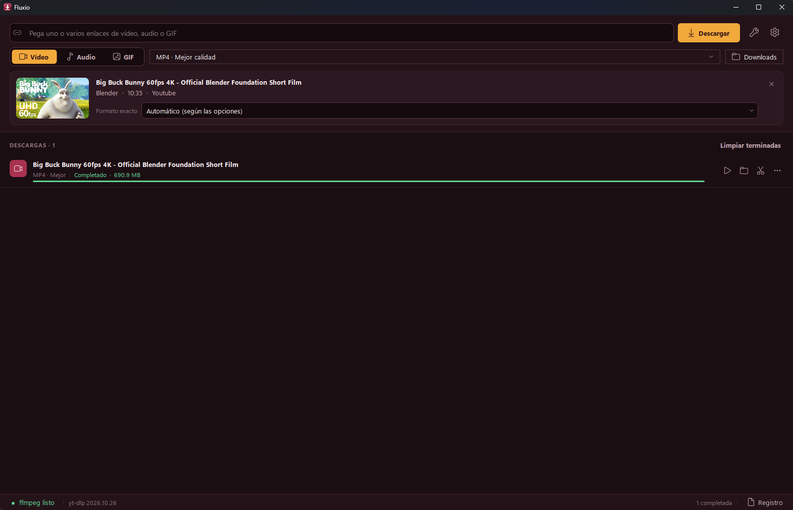

<p align="center">
  
</p>

<h1 align="center">Fluxio</h1>

<p align="center">
  Descargador de vídeo, audio y GIF para Windows, con recorte visual y editor de volumen.<br>
  Hecho con <b>PySide6</b>, <b>yt-dlp</b> y <b>ffmpeg</b>.
</p>

---

<p align="center">
  
</p>

<p align="center"><sub>
  Vídeo de ejemplo: <i>Big Buck Bunny</i> © Blender Foundation |
  <a href="https://peach.blender.org">peach.blender.org</a>, bajo licencia
  <a href="https://creativecommons.org/licenses/by/3.0/">CC BY 3.0</a>.
</sub></p>

## Qué hace

- **Descarga vídeo, audio o GIF** de YouTube, X/Twitter, Reddit, Instagram, TikTok, Twitch y [cientos de sitios más](https://github.com/yt-dlp/yt-dlp/blob/master/supportedsites.md).
- **Vista previa automática:** al pegar un enlace muestra la miniatura, el título y la duración, y deja elegir el **formato exacto** (resolución, códec y tamaño reales).
- **Varias descargas a la vez** (de 1 a 4), con **reintento automático** si fallan y **notificación de Windows** al terminar.
- **Audio:** mp3, m4a, opus, flac o wav, con **normalización de volumen** a −14 LUFS (el nivel de Spotify) y ajuste manual en dB.
- **GIF:** guarda GIF de Giphy, Tenor o Imgur tal cual, y convierte vídeos a GIF con paleta optimizada.
- **Recortar viendo el vídeo:** reproductor con línea de tiempo y marcadores de inicio y fin. Puede guardar como copia o sobrescribir el original.
- **Editor de volumen** para audios ya descargados.
- **Comodidad:**
  - Detecta enlaces copiados.
  - Puedes arrastrar y soltar enlaces o archivos sobre la ventana.
  - Plantilla de nombre de archivo configurable.
  - Usa las cookies de tu navegador para contenido con restricción de edad o que pide iniciar sesión.
- **Versión portable:** un único `.exe` que no necesita Python instalado.

## Requisitos

- **Windows 10 u 11.** Los iconos usan las fuentes de iconos de Windows; en otros sistemas la app funciona, pero los iconos se ven como símbolos sencillos.
- **Para ejecutar desde el código:** Python 3.10 o superior (probado con Python 3.15).
- **ffmpeg:** no hace falta instalarlo aparte, porque se instala con `imageio-ffmpeg`. Ver [ffmpeg](#ffmpeg).

## Instalación y uso desde el código

```bash
git clone https://github.com/Dreex14/fluxio.git
cd fluxio
pip install -r requirements.txt
pythonw main.pyw
```

- `pythonw` abre la app sin ventana de consola. Usa `python main.pyw` si quieres ver los mensajes de error en la consola.
- Para tenerla en el menú Inicio con su icono, ejecuta una vez:

  ```bash
  python crear_acceso_directo.py
  ```

  Después puedes anclarla a Inicio o a la barra de tareas con clic derecho.

## Cómo se usa

1. **Pega un enlace** en la barra superior (o varios, separados por espacios o saltos de línea).
2. Elige **Vídeo**, **Audio** o **GIF**.
3. Pulsa el botón con el resumen de opciones (por ejemplo `MP4 · Mejor calidad`) para cambiar calidad, formato, subtítulos, etc. Las opciones se recuerdan para la próxima vez.
4. Pulsa **Descargar** o **Enter**.

Cada descarga de la cola tiene sus propias acciones: abrir, mostrar en la carpeta, recortar, editar volumen, reintentar, ver su registro o cancelar. El botón **⋯** tiene más opciones (copiar enlace, abrir en el navegador, quitar de la lista).

### Atajos de teclado

| Atajo | Acción |
|---|---|
| `Ctrl+V` | Pega en la barra de enlaces desde cualquier parte de la ventana |
| `Enter` | Descarga los enlaces de la barra |
| `Ctrl+L` | Va a la barra de enlaces |
| `Ctrl+,` | Abre los Ajustes |
| `Esc` | Cierra el panel de opciones |

**En el editor de recorte:**

| Atajo | Acción |
|---|---|
| `Espacio` | Reproducir / pausa |
| `I` / `O` | Marcar inicio / fin en la posición actual |
| `←` / `→` | Retroceder / avanzar 1 s (`Mayús` para 5 s) |
| `Inicio` / `Fin` | Ir al inicio / fin de la selección |

### Recortar un vídeo o un audio

Ábrelo desde el botón ✂ de una descarga terminada, desde **Herramientas → Recortar** o arrastrando el archivo a la ventana.

- **Rápido:** no vuelve a codificar, así que es instantáneo y sin pérdida. El corte empieza en el fotograma clave anterior, por lo que puede empezar un poco antes del punto marcado.
- **Preciso:** corta en el punto exacto, pero vuelve a codificar (tarda más y pierde un poco de calidad).
- **Guardar como copia nueva** o **sobrescribir el original** (pide confirmación; no se puede deshacer).

> Para descargar solo un fragmento sin bajar el vídeo entero, usa la opción **«Descargar solo un fragmento»** e indica los tiempos (`90`, `1:30` o `1:02:03`).

### Nombre de los archivos

En **Ajustes → Nombre de archivo** puedes combinar estas etiquetas:

| Etiqueta | Se sustituye por |
|---|---|
| `{titulo}` | Título del vídeo |
| `{canal}` | Canal o autor |
| `{id}` | Identificador del vídeo |
| `{fecha}` | Fecha de publicación (AAAA-MM-DD) |
| `{sitio}` | Web de origen (Youtube, Twitter…) |
| `{resolucion}` | Resolución (1920x1080…) |

La plantilla por defecto es `{titulo} [{id}]`. Si usas `/`, se crean subcarpetas (por ejemplo `{canal}/{titulo}`).

## Compilar la versión portable (.exe)

La versión portable es un **único archivo `Fluxio.exe`** que funciona en cualquier Windows sin instalar Python.

### Opción rápida

Haz doble clic en **`compilar_exe.bat`**, o ejecútalo desde una terminal en la carpeta del proyecto:

```bash
compilar_exe.bat
```

El script hace esto:
1. Instala las dependencias y **PyInstaller**.
2. Compila la app (tarda unos minutos).
3. Deja el resultado en **`dist\Fluxio.exe`**.

Ese `.exe` es todo lo que necesitas: cópialo donde quieras (otra carpeta, un USB…).

### ¿ffmpeg dentro o fuera del .exe?

Al principio de `compilar_exe.bat` hay una variable:

```bat
set INCLUIR_FFMPEG=1
```

| Valor | Resultado |
|---|---|
| `1` (por defecto) | ffmpeg va **dentro** del `.exe`. Es más cómodo (un solo archivo), pero pesa más. |
| `0` | El `.exe` es más ligero y se genera también `dist\ffmpeg.exe`. **Mantén los dos archivos en la misma carpeta.** |

### Compilar a mano

Si prefieres no usar el `.bat`:

```bash
pip install -r requirements.txt pyinstaller
python -m PyInstaller --noconfirm --clean --onefile --windowed --name "Fluxio" --icon icon.ico --add-data "icon.ico;." --collect-submodules yt_dlp --copy-metadata yt-dlp --collect-all imageio_ffmpeg main.pyw
```

### Qué debes saber de la versión portable

- **Los ajustes se guardan en `ajustes.ini`, junto al `.exe`**, así que puedes llevártela a otro equipo con tu configuración.
- **Actualizar yt-dlp desde la propia app** (Herramientas → Actualizar yt-dlp) descarga la versión nueva en la carpeta `yt-dlp_actualizado\`, junto al `.exe`. Si esa carpeta no permite escribir, se usa `%APPDATA%\Fluxio\`. **Cierra y vuelve a abrir la app** para usarla.
- **El primer arranque tarda unos segundos**, porque un `.exe` de un solo archivo se descomprime en una carpeta temporal cada vez que se abre.
- **Algunos antivirus marcan los `.exe` hechos con PyInstaller como sospechosos** (falso positivo habitual). Si pasa, añade una excepción o compila tú mismo el `.exe` desde el código.

## ffmpeg

Fluxio necesita ffmpeg para unir vídeo y audio, convertir formatos, normalizar el volumen, crear GIF y recortar. Lo busca en este orden:

1. La ruta elegida a mano en **Ajustes → ffmpeg**.
2. Un `ffmpeg.exe` en la misma carpeta que la app.
3. El `PATH` del sistema.
4. El que instala `imageio-ffmpeg` (incluido en `requirements.txt`).

La barra inferior indica si ffmpeg está listo. Si aparece en amarillo, púlsalo para configurarlo.

## Dónde se guardan los ajustes

| Cómo se ejecuta | Dónde |
|---|---|
| Versión portable (`.exe`) | `ajustes.ini`, junto al `.exe` |
| Desde el código, si existe `ajustes.ini` junto a `main.pyw` | Ese `ajustes.ini` |
| Desde el código, sin `ajustes.ini` | Registro de Windows (`HKEY_CURRENT_USER\Software\Fluxio\Fluxio`) |

## Solución de problemas

- **«Sign in to confirm your age», contenido privado o que pide iniciar sesión:** en **Ajustes → Cookies del navegador** elige el navegador donde tienes la sesión iniciada. **Firefox es el más fiable.** Con Chrome o Edge puede fallar si el navegador está abierto mientras descargas.
- **Errores 403 o «Unable to extract» de un sitio que antes funcionaba:** casi siempre se arreglan actualizando yt-dlp (**Herramientas → Actualizar yt-dlp**) y reiniciando la app.
- **Aviso de YouTube sobre «JavaScript runtime»:** yt-dlp recomienda tener [Deno](https://deno.com/) instalado para algunos formatos de YouTube. Las descargas suelen funcionar igual sin él.
- **Ver qué ha pasado en una descarga fallida:** pulsa el icono de registro de esa fila, o abre **Registro** en la barra inferior.
- **Cancelar mientras ffmpeg procesa:** la cancelación se aplica al terminar el paso actual (unir, convertir o normalizar).

## Estructura del proyecto

```
main.pyw                  punto de entrada
fluxio/
  paths.py                rutas y carga del yt-dlp actualizado
  media.py                operaciones con ffmpeg: volumen, normalización, GIF y recorte
  engine.py               opciones de yt-dlp, hilos de descarga y cola
  theme.py                colores, hoja de estilos e iconos
  widgets.py              componentes de la interfaz
  dialogs.py              ajustes, editor de volumen, editor de recorte y registro
  app.py                  ventana principal
compilar_exe.bat          genera la versión portable
crear_acceso_directo.py   crea el acceso directo en el menú Inicio
requirements.txt          dependencias
icon.ico / icon.png       icono de la app
```

## Aviso legal y exención de responsabilidad

> [!IMPORTANT]
> **El autor de Fluxio no se hace responsable de lo que se descargue con el programa.**

Fluxio no aloja, distribuye ni controla ningún contenido: solo ofrece una interfaz para herramientas de terceros que se ejecutan en tu equipo. **Cada usuario es el único responsable** de:

- el contenido que descarga, convierte, recorta o comparte;
- cumplir la ley de su país, los derechos de autor y los términos de uso de cada sitio web.

Descarga solo contenido que tengas derecho a guardar: por ejemplo, contenido propio, con licencia libre o con permiso de su autor. Tienes el texto completo en [LICENSE](LICENSE).

## Créditos

**Fluxio no reinventa la descarga de vídeos.** El trabajo de fondo lo hacen herramientas libres y conocidas que cualquiera puede usar por su cuenta. Fluxio las reúne en una interfaz cómoda y añade funciones propias:

- vista previa con formato exacto;
- cola con descargas simultáneas y reintentos;
- recorte visual con reproductor;
- normalización y editor de volumen;
- conversión a GIF con búsqueda en la página;
- detección del portapapeles, arrastrar y soltar, plantillas de nombre y versión portable.

Todo el mérito de esas herramientas es de sus autores:

| Proyecto | Para qué lo usa Fluxio | Licencia |
|---|---|---|
| [yt-dlp](https://github.com/yt-dlp/yt-dlp) | Analizar enlaces y descargar de cientos de sitios | The Unlicense |
| [FFmpeg](https://ffmpeg.org/) | Unir vídeo y audio, convertir, normalizar, crear GIF y recortar | LGPL / GPL |
| [imageio-ffmpeg](https://github.com/imageio/imageio-ffmpeg) | Proporcionar un ffmpeg listo para usar | BSD 2-Clause (sus binarios de FFmpeg son GPL) |
| [Qt](https://www.qt.io/) / [PySide6](https://doc.qt.io/qtforpython/) | Interfaz gráfica y reproductor del editor de recorte | LGPLv3 |
| [PyInstaller](https://pyinstaller.org/) | Generar el `.exe` portable | GPL con excepción para empaquetado |

La captura de pantalla muestra **[Big Buck Bunny](https://peach.blender.org)** (2008), cortometraje de la **[Blender Foundation](https://www.blender.org/foundation/)** publicado bajo licencia [Creative Commons Attribution 3.0](https://creativecommons.org/licenses/by/3.0/). © Blender Foundation | www.bigbuckbunny.org.

Los iconos de la interfaz usan las fuentes **Segoe Fluent Icons / Segoe MDL2 Assets** que ya trae Windows; no se incluyen en el proyecto. Los nombres y marcas mencionados pertenecen a sus propietarios.

## Licencia

El código propio de Fluxio se publica bajo la [licencia MIT](LICENSE), que incluye la exención de responsabilidad anterior. Las herramientas de terceros mantienen sus propias licencias.

Si distribuyes el `.exe` portable con ffmpeg incluido, también estás distribuyendo FFmpeg y Qt, y debes respetar sus licencias (GPL/LGPL).

---

<p align="center">Hecho por <b>Dreex</b></p>
